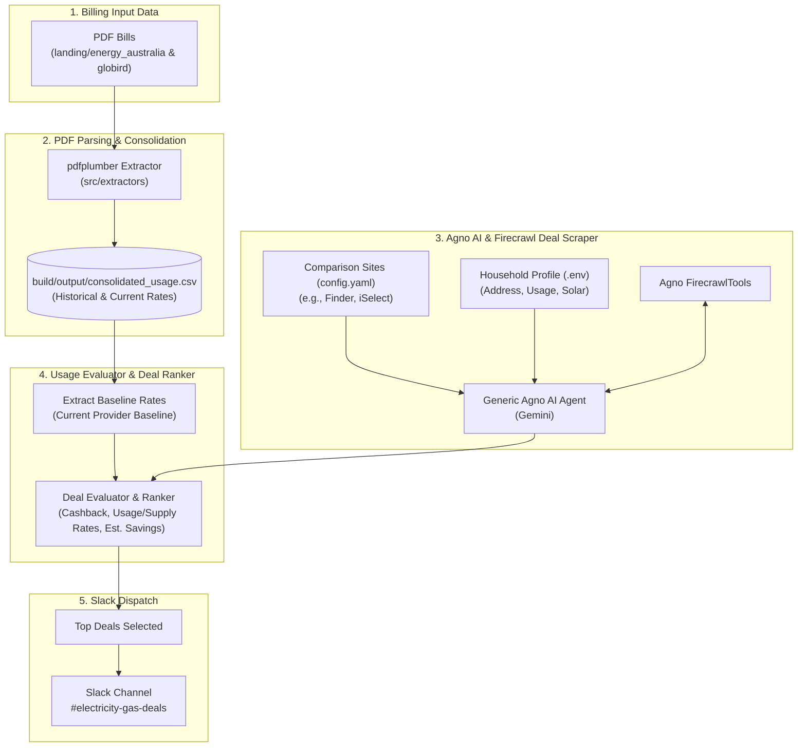

# ⚡ Electricity & Gas Usage Analysis & Energy Deals Monitor

A comprehensive toolkit and AI Agent for processing household electricity/gas utility bills from providers (**EnergyAustralia**, **GloBird Energy**), evaluating baseline usage rates, scanning comparison websites (such as **Finder.com.au**, **iSelect.com.au**) via **Agno AI** & **Firecrawl**, and sending top energy deal notifications to **Slack**.

---

## 🏗️ Architecture & Data Flow



---

## 📌 Project Overview

This workspace automates end-to-end energy management and deal monitoring:
1. **Bill Identification & Standardized Renaming**: Automatically extracts provider, utility type, and issue date from raw PDF bills and renames them to a consistent naming format.
2. **Data Extraction & Consolidation**: Parses PDF bill statements (usage kWh/MJ, supply rates, billing periods, GST, discounts) and exports clean structured data into `build/output/consolidated_usage.csv`.
3. **Agno Firecrawl Energy Deals Monitor**: Scans configured energy comparison sites dynamically for your property address and usage levels (configured securely in `.env`), comparing live energy market deals against your actual usage baseline.
4. **Deal Ranking & Slack Notifications**: Ranks deals based on cashback bonuses, lower daily supply charges, lower usage charges, and estimated annual savings, posting top cards to Slack.

---

## 📁 Repository Structure

```
electricity_gas_usage/
├── config.yaml                       # Application settings & targets (Comparison URLs, prompt template, Slack channel)
├── landing/                          # Raw incoming PDF bills directory
├── src/
│   ├── models/                       # Pydantic data models (EnergyDealItem, EnergyDealList, HouseholdProfile)
│   ├── extractors/                   # PDF bill parser functions & consolidation
│   ├── agents/                       # Generic Agno AI deal scraper agent with FirecrawlTools
│   ├── evaluators/                   # Baseline metric evaluator & top deal ranker
│   ├── notifiers/                    # Slack deal card and summary notifications dispatcher
│   └── config.py                     # Environment and configuration manager
├── main.py                           # Energy monitor orchestrator CLI entry point
├── run_energy_monitor.sh             # Bash runner script
├── build/
│   ├── output/
│   │   └── consolidated_usage.csv    # Consolidated billing dataset
│   └── seen_energy_deals.json        # Deduplication tracker for notified deals
├── requirements.txt                  # Python dependencies
└── README.md                         # Project documentation
```

---

## 🚀 Getting Started

### 1. Environment Setup

```bash
# Activate your python/conda environment
conda activate ai

# Install project dependencies
pip install -r requirements.txt
```

### 2. Environment Variables (`.env`)

Create a `.env` file in the root directory (copy from `.env.example`):

```env
GOOGLE_API_KEY=your_gemini_api_key
FIRECRAWL_API_KEY=your_firecrawl_api_key
SLACK_WEBHOOK_URL=your_slack_incoming_webhook_url

# Household / Property Profile Configuration (Stored securely in .env)
HOUSEHOLD_ADDRESS="123 Example Street, Suburb, VIC 3000"
HOUSEHOLD_SUBURB="Your Suburb"
HOUSEHOLD_STATE="VIC"
HOUSEHOLD_POSTCODE="3000"
HOUSEHOLD_ELECTRICITY_USAGE="Medium"
HOUSEHOLD_GAS_USAGE="Medium"
HOUSEHOLD_HAS_SOLAR="true"
```

---

## ⚙️ Workflow & Usage

### 1. Run Agno Firecrawl Energy Deals Scan
Run the main orchestrator to scan comparison sites configured in `config.yaml`, evaluate market deals against your usage baseline, and post the Top Deals to Slack:

```bash
python main.py
```
